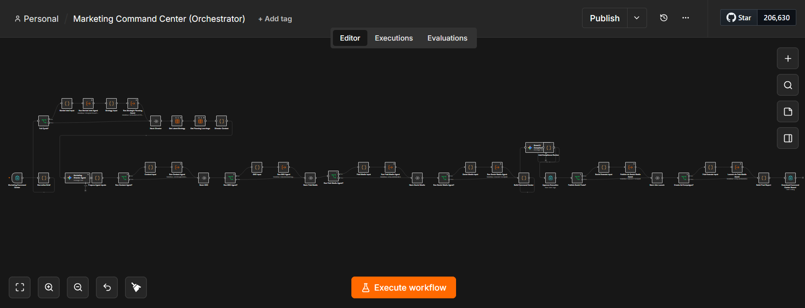
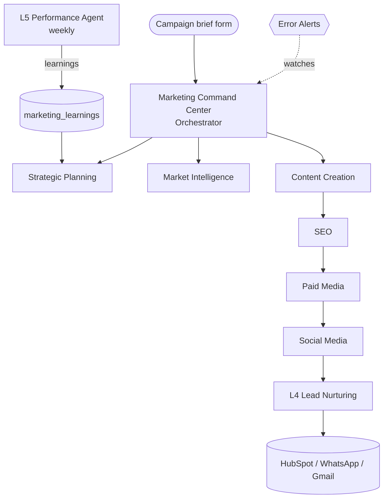
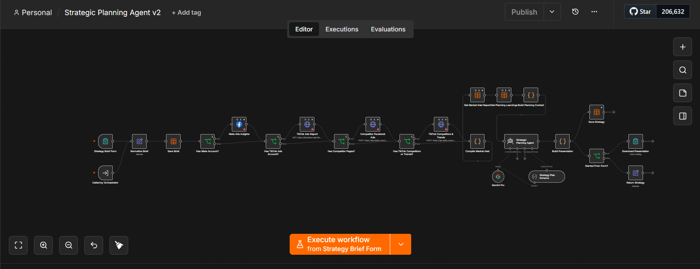
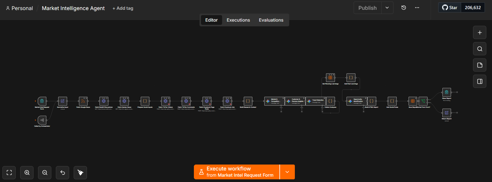
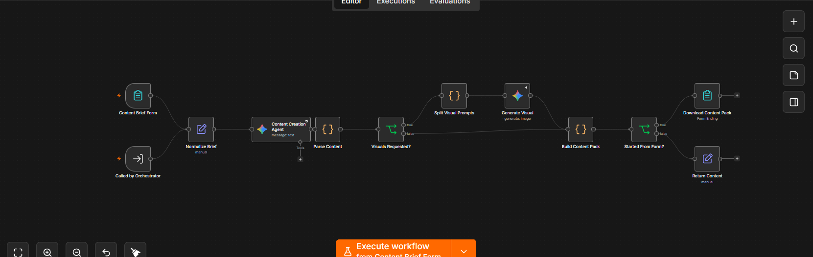
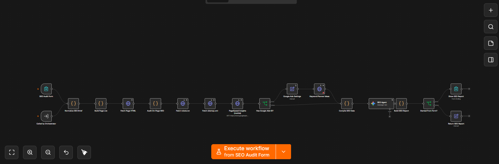
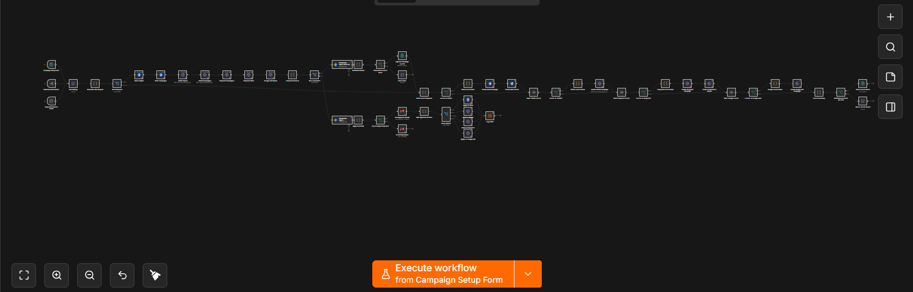
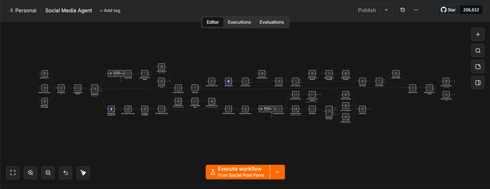
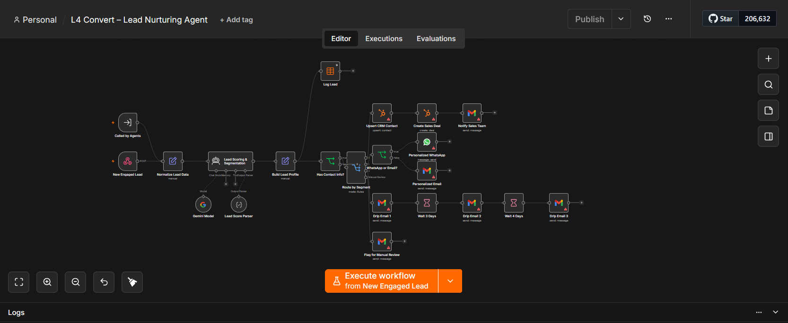
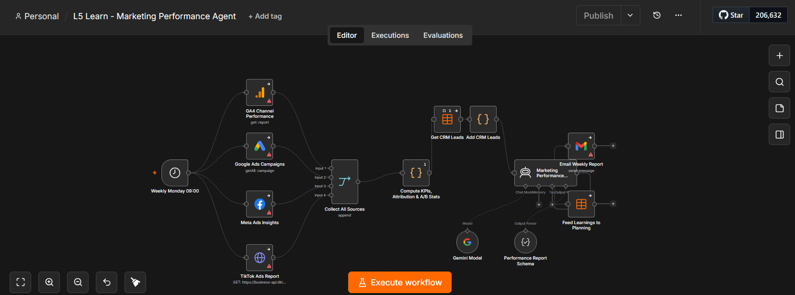

# AI Marketing Agents — n8n Workflows

A multi-agent marketing system built with **n8n** and **Google Gemini**. A central orchestrator turns one campaign brief into strategy, market research, content, SEO, paid ads, social publishing, lead nurturing and weekly performance learning, with each agent also usable on its own through a form.

## How it fits together

## Workflows

### `marketing-system/`

| # | Workflow | What it does | Trigger | Main tools |
|---|----------|--------------|---------|------------|
| 00 | [Orchestrator](marketing-system/00-orchestrator.json) | A Gemini "Marketing Director" writes one campaign idea, briefs every agent and runs them in order | Form | Gemini, Execute Workflow |
| 01 | [Strategic Planning Agent](marketing-system/01-strategic-planning-agent.json) | Builds a full strategy (positioning, channel mix & budget, campaigns, calendar, KPIs) and exports it as an HTML deck | Form / Orchestrator | Gemini agent, Meta & TikTok Ads data |
| 02 | [Market Intelligence Agent](marketing-system/02-market-intelligence-agent.json) | Collects competitor and trend data from TikTok, Facebook and RSS, then summarizes insights | Form / Orchestrator | Apify, RSS, Gemini |
| 03 | [Content Creation Agent](marketing-system/03-content-creation-agent.json) | Writes blog articles, social posts, ad copy and landing-page copy using live search trends | Form / Orchestrator | Gemini + Google Search |
| 04 | [SEO Agent](marketing-system/04-seo-agent.json) | Crawls pages, runs technical checks (robots, sitemap, Core Web Vitals) and suggests keywords and fixes | Form / Orchestrator | PageSpeed Insights, Google Ads Keyword Planner, Gemini |
| 05 | [Paid Media Agent](marketing-system/05-paid-media-agent.json) | Sets up campaigns on Meta, TikTok, Snapchat and Google Ads, then checks performance daily | Form / Orchestrator / Daily | Meta Graph API, Ads APIs, Gemini |
| 06 | [Social Media Agent](marketing-system/06-social-media-agent.json) | Publishes posts with email approval and handles community replies every 2 hours | Form / Orchestrator / Schedule | Meta Graph API, Gmail, Gemini |
| 07 | [L4 Lead Nurturing Agent](marketing-system/07-lead-nurturing-agent.json) | Scores leads 0–100, sends personalized WhatsApp/email outreach, drip campaigns, and hands hot leads to sales | Called by agents / Webhook | Gemini, HubSpot, WhatsApp, Gmail |
| 08 | [L5 Performance Agent](marketing-system/08-performance-agent.json) | Weekly report: ROI, ROAS, CPA, A/B test significance, and learnings fed back to planning | Every Monday 09:00 | GA4, Google Ads, Meta, TikTok, Gemini |
| 09 | [Error Alerts](marketing-system/09-error-alerts.json) | Emails an alert whenever any agent fails | Error trigger | Gmail |

### `standalone/`

| Workflow | What it does | Trigger |
|----------|--------------|---------|
| [AI News Email Alerts](standalone/ai-news-email-alerts.json) | Reads AI news RSS feeds, removes duplicates, summarizes with Gemini and emails a digest | Every 3 hours |

### `archive/`
Earlier versions and test workflows, kept for reference.

## Screenshots

<b>01 · Strategic Planning Agent</b>

<b>02 · Market Intelligence Agent</b>

<b>03 · Content Creation Agent</b>

<b>04 · SEO Agent</b>

<b>05 · Paid Media Agent</b>

<b>06 · Social Media Agent</b>

<b>07 · L4 Lead Nurturing Agent</b>

<b>08 · L5 Performance Agent</b>

## How to import

1. In n8n, open **Workflows → Import from File** and pick a `.json` file.
2. Reconnect the credentials each workflow needs (Gemini, Gmail, Meta Graph API, HubSpot, etc.). **Credentials are not included in this repo.**
3. Fill in the setup values described in the sticky notes inside each workflow (account IDs, page IDs, emails).
4. For the full system, import every file in `marketing-system/`, then open the Orchestrator and re-select each sub-workflow in its **Execute Workflow** nodes, because workflow IDs change on import.
5. Replace `your-email@example.com` with your own address where it appears.
